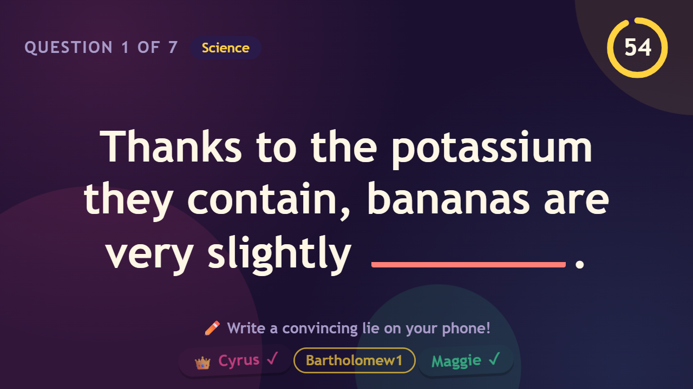
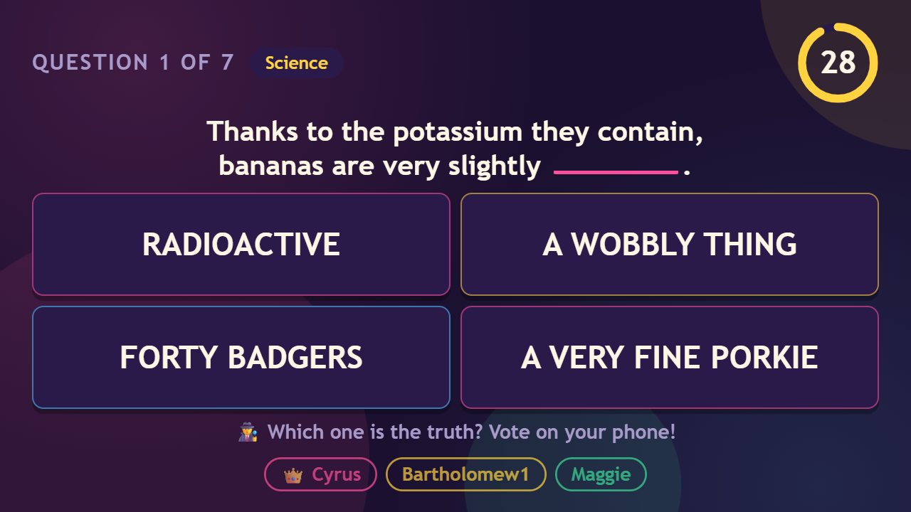
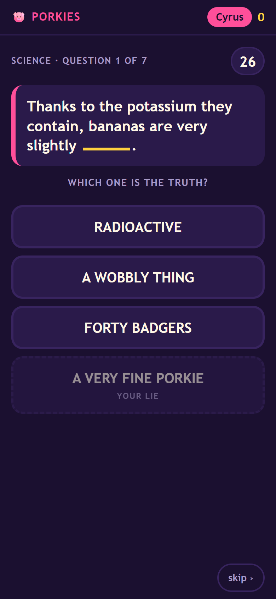
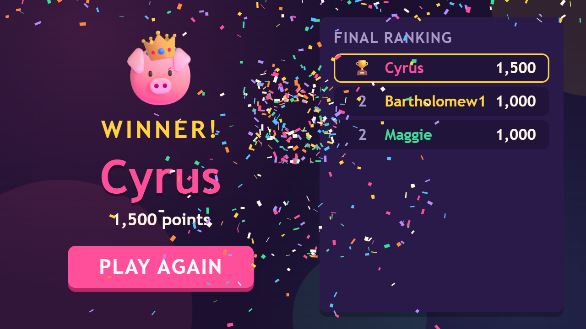

# 🐷 Porkies

**Tell a whopper, spot the truth.** A bluffing trivia party game you host on your own
laptop and play with friends on the same Wi-Fi — one shared screen, everyone's phone as
a controller, no accounts and no internet needed once it's installed.



## How it plays

1. Everyone sees a strange-but-true fact with a blank in it.
2. Each player secretly writes a convincing lie to fill the blank.
3. All the lies appear alongside the real answer, and everyone picks the one they think is true.
4. You score for finding the truth — and for every friend who falls for your lie.

| On the big screen | On your phone |
|---|---|
|  |  |



## Features

- **2–12 players**, phones as controllers — nothing to install for players
- **120 original questions** across animals, history, words, food, sport, odd laws and more
- **Two modes**
  - **Classic** — 7 questions, 60s to write, 30s to vote, double and triple points late on
  - **Quickfire ⚡** — 12 questions, 25s to write, 15s to vote, plus a ❤ bonus for the
    best-loved lie each round
- **Procedural soundtrack and sound effects** made in the browser with WebAudio — no audio files
- **QR code join**, automatic reconnect if a phone drops, late joiners welcome, kick from the lobby
- **No build step** — plain Node, Express, Socket.IO and vanilla JS

## Quick start

You need [Node.js](https://nodejs.org) (built and tested on Node 20).

```bash
git clone https://github.com/CubeB/porkies.git
cd porkies
npm install
npm start
```

Then:

- Open **http://localhost/host** on the screen everyone can see (click once to start the music).
- Players join on the same Wi-Fi by **scanning the QR code** on that screen.
- The first player to join gets a Start button on their phone; there is one on the big screen too.

If port 80 is busy the server falls back to port 3000 and prints the address to use.
On Windows, allow Node through the firewall on private networks when prompted.

## Scoring

| | Classic | Quickfire |
|---|---|---|
| Picking the truth | 1000 × multiplier | 1000 × multiplier |
| Each player fooled by your lie | 500 × multiplier | 500 × multiplier |
| Best porkie (most ❤) | — | 250 × multiplier |
| Multipliers | ×1, ×1, ×1, ×2, ×2, ×2, ×3 | ×1 for 1–6, ×2 for 7–11, ×3 for 12 |

Type the real answer by accident and you'll be asked for a different lie. Identical lies
from several players merge into one option and every author gets the points. If there
aren't enough lies, the game slips in a few of its own.

## A friendly join address (optional)

By default the lobby tells players to go to `cyrus.game`. That name only works if the
devices on your network are told it points at your computer; the QR code needs no setup
and is the easy route. To use a name:

1. Pick your own with `JOIN_HOST=quiz.night npm start` (and `GAME_DOMAIN=quiz.night` below).
2. Run the bundled DNS helper in a second terminal: `node dns.js`. It answers that one
   name with your computer's LAN address and forwards every other lookup to a normal DNS server.
3. Point devices at it, either
   - **on the router** — set the DHCP/LAN DNS server to your computer's address, or
   - **per phone** — Wi-Fi settings → your network → DNS → Manual.

Put the router setting back afterwards (or keep `dns.js` running), otherwise nothing on
the network can look up websites. Android "Private DNS" and iPhone "iCloud Private Relay"
bypass local DNS, so those phones should use the QR code.

## Configuration

Environment variables, all optional:

| Variable | Default | What it does |
|---|---|---|
| `PORT` | `80` (falls back to `3000`) | Port for the game server |
| `JOIN_HOST` | `cyrus.game` | Address shown to players in the lobby |
| `QUESTIONS_FILE` | `questions.json` | Use a different question bank |
| `FAST` | off | `FAST=1` divides every timer by 10, for testing |
| `GAME_DOMAIN` | `cyrus.game` | Name(s) `dns.js` answers for, comma-separated |
| `UPSTREAM_DNS` | `1.1.1.1` | Where `dns.js` forwards everything else |

## Add your own questions

`questions.json` is a plain array. Each entry looks like this:

```json
{
  "id": 121,
  "category": "Animals",
  "text": "A group of flamingos is called a _____.",
  "answer": "flamboyance",
  "alternates": ["a flamboyance"],
  "decoys": ["blush", "stilt", "parade", "rosette"]
}
```

- `text` needs exactly one `_____` (five underscores) where the answer goes.
- `alternates` are other ways of typing the truth, so players can't submit it as a lie.
- `decoys` are four believable lies the game can use to pad out the options.

The bundled questions were written from general knowledge and have not been
independently fact-checked — corrections are welcome.

## Project layout

```
server.js        game server: players, timers, scoring, state for every screen
questions.json   the question bank
public/
  host.*         the big-screen view, served at /host
  index.html     the phone controller, served at /
  player.*
dns.js           optional helper for a friendly join address
```

The server is the single source of truth: it sends each screen a full snapshot of the
game whenever anything changes, and the clients simply draw what they are given.
